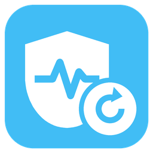

# ha-integration-watchdog

[](https://github.com/hacs/integration)
[](https://github.com/juju35/ha-integration-watchdog/actions/workflows/hacs.yml)
[](https://github.com/juju35/ha-integration-watchdog/actions/workflows/validate.yml)
[](https://github.com/juju35/ha-integration-watchdog/releases/latest)
[](LICENSE)

<p align="center"></p>

Home Assistant integration that watches your integrations and reloads the ones whose entities are all unavailable, except those you choose to ignore.

Some integrations lose their connection (cloud API, device reboot, expired session) and never recover until they are reloaded by hand. Integration Watchdog does that reload for you.

[](https://my.home-assistant.io/redirect/hacs_repository/?owner=juju35&repository=ha-integration-watchdog&category=integration)

## Features

- **Automatic check** at a set interval (5 minutes by default) of every loaded integration
- **Reload** of an integration once all its enabled entities have been `unavailable` for the grace period (15 minutes by default)
- **Never during startup**: nothing is reloaded while Home Assistant starts or stops, nor during the grace period after it has started
- **No reload loop**: an integration that stays unavailable is reloaded at most 3 times in a row (configurable), the delay between two reloads doubling each time; then the watchdog gives up on it until it recovers
- **Notification** for each reload, failed reload and give-up: persistent notification, and optionally your notify actions (mobile app…)
- **Ignored integrations**, chosen in the integration options among those set up, or typed as a domain
- **Check now** button and `integration_watchdog.check` action
- **Unavailable integrations** sensor with the list, **Last reload** sensor, **Last check** sensor
- `integration_watchdog_reloaded` **event** for each reload, to notify or log
- One failing reload doesn't stop the others; two checks never run at the same time
- English, French, German and Spanish

## Prerequisites

- Home Assistant 2024.12 or newer
- Nothing else: the watchdog only uses Home Assistant's own registries and the integrations' **Reload**. The [System Monitor Card](https://github.com/juju35/ha-system-monitor-card) can show its sensors on a dashboard

## Installation

### Via HACS (recommended)

Click the button below to add the repository directly:

[](https://my.home-assistant.io/redirect/hacs_repository/?owner=juju35&repository=ha-integration-watchdog&category=integration)

Then click **Download** and restart Home Assistant.

Or manually:

1. Open HACS → **⋮** (top right) → **Custom repositories**
2. Add `https://github.com/juju35/ha-integration-watchdog` — Type: **Integration**
3. Search for **Integration Watchdog** and click **Download**
4. Restart Home Assistant

### Manual

Copy `custom_components/integration_watchdog/` to `/config/custom_components/integration_watchdog/`, then restart Home Assistant.

## Configuration

[](https://my.home-assistant.io/redirect/config_flow_start/?domain=integration_watchdog)

**Settings → Devices & services → Add integration → Integration Watchdog**. Change the options later with the **Configure** button.

| Option | Default | Description |
|---|---|---|
| Check interval | 5 min | Minutes between two checks, from 1 to 1440 |
| Grace period | 15 min | Minutes every entity of an integration must have been unavailable before it is reloaded. Nothing is reloaded during this time after Home Assistant has started |
| Reloads in a row | 3 | Reloads of an integration that stays unavailable before giving up on it, from 1 to 10 |
| Ignored integrations | none | Integrations never reloaded. The list offers the integrations set up; type a domain (`zha`, `mqtt`…) to add another one |
| Notify actions | none | Also send each notification with these actions (`notify.mobile_app_phone`…). A persistent notification is always created |

### What counts as unavailable

An integration (config entry) is reloaded when:

- it is loaded, or its setup failed (`setup_retry`, `setup_error`): a reload retries it right away instead of waiting for Home Assistant's next retry. Disabled integrations are left alone
- it is not ignored, and it is not a helper (template, group, utility meter, derivative…): their entities follow their sources, so reloading them can't fix anything
- it has at least one enabled entity, and **every** enabled entity is `unavailable`
- the most recent of these entities has been unavailable for at least the grace period
- Home Assistant has been running for at least the grace period

Disabled entities are left out. Entities the integration didn't create, for example because the device was off or unreachable when it loaded (shown as "not provided" in Home Assistant), count as unavailable. An integration with a single entity still available is not reloaded.

The check is per integration entry, not per device: an entry with one device down and another one working is left alone.

### Limiting reloads

An integration that stays unavailable after a reload is reloaded again after the grace period, then after twice the grace period, and so on, up to the **Reloads in a row** option. With the defaults: after 15 minutes, then 15 minutes later, then 30 minutes later. If it is still unavailable once the delay after the last one has passed (60 minutes with the defaults), the watchdog gives up on it, sends a notification, and doesn't touch it again until one of its entities has been available for the current delay, counted from its return. An integration that comes back for a moment and falls again keeps its count. Leaving the list is not a recovery: an integration whose setup or unload is still in progress (a reload that went past its timeout), or that has no enabled entity with a state keeps its count until one of its entities is actually available. Disabling an integration resets its count right away, even if you enable it again a few seconds later: once enabled again, it starts over.

A reload that doesn't finish within 5 minutes, or a notify action that doesn't answer within 30 seconds, counts as failed, so that a hung integration can't block the following checks.

The count is kept in memory: restarting Home Assistant starts over. Changing the options keeps it, so an integration given up stays so (until a higher **Reloads in a row** allows more reloads).

### Notifications

Each reload, failed reload and give-up creates a persistent notification, one per integration (the next one replaces it), in the language of Home Assistant. The same title and message are sent to the notify actions chosen in the options.

### Entities

| Entity | Description |
|---|---|
| `button.integration_watchdog_check_now` | Runs a check now. Unavailable while one is running |
| `sensor.integration_watchdog_unavailable_integrations` | Number of integrations whose entities are all unavailable. Attributes: `integrations` (list of `domain`, `title`, `entry_id`, `since`, `reloads`, `gave_up`), `ignored` |
| `sensor.integration_watchdog_last_reload` | Time of the last reload. Attributes: `domain`, `title`, `entry_id`, `success`, `reloads` (since Home Assistant started) |
| `sensor.integration_watchdog_last_check` | End of the last check |

### Action `integration_watchdog.check`

Runs a check now and waits for the reloads. If a check is already running, waits for it to end, then runs its own. For administrators. Does nothing while Home Assistant is starting.

```yaml
action: integration_watchdog.check
```

### Event `integration_watchdog_reloaded`

| Field | Description |
|---|---|
| `entry_id` | Config entry reloaded |
| `domain` | Integration domain |
| `title` | Config entry title |
| `success` | `true` if the integration loaded again |
| `unavailable_since` | When its last entity became unavailable |
| `attempt` | Reload number in a row (1, 2…) |
| `max_reloads` | Reloads in a row before giving up |

Log each reload in the logbook:

```yaml
triggers:
  - trigger: event
    event_type: integration_watchdog_reloaded
actions:
  - action: logbook.log
    data:
      name: Integration Watchdog
      message: >
        reloaded {{ trigger.event.data.title }} ({{ trigger.event.data.domain }}),
        attempt {{ trigger.event.data.attempt }}/{{ trigger.event.data.max_reloads }}
```

## Screenshots

The watchdog has no card of its own: its sensors are shown by the [System Monitor Card](https://github.com/juju35/ha-system-monitor-card), here with two unavailable integrations, the last reload and the **Check now** button.


## How it works

At each interval, the integration goes through the config entries, reads the states of their entities from the entity registry, and reloads the qualifying entries one at a time, as the **Reload** menu of the integration does. No check runs before Home Assistant has fully started; the first check runs right after, and only lists the unavailable integrations until the grace period has passed.

To debug:

```yaml
logger:
  logs:
    custom_components.integration_watchdog: debug
```

## Development

```bash
pip install -r requirements_test.txt && pytest
```

### Releasing

1. Bump the version in `custom_components/integration_watchdog/manifest.json`
2. Add a `## <version>` section at the top of [CHANGELOG.md](CHANGELOG.md)
3. Push to `main`: the **Release** workflow creates the tag and the GitHub release with the changelog section as notes

## Translations

The integration follows the language of Home Assistant. Currently supported:

| Language | Code |
|---|---|
| English | `en` |
| Français | `fr` |
| Deutsch | `de` |
| Español | `es` |

Contributions for additional languages are welcome!

## License

[MIT](LICENSE)
